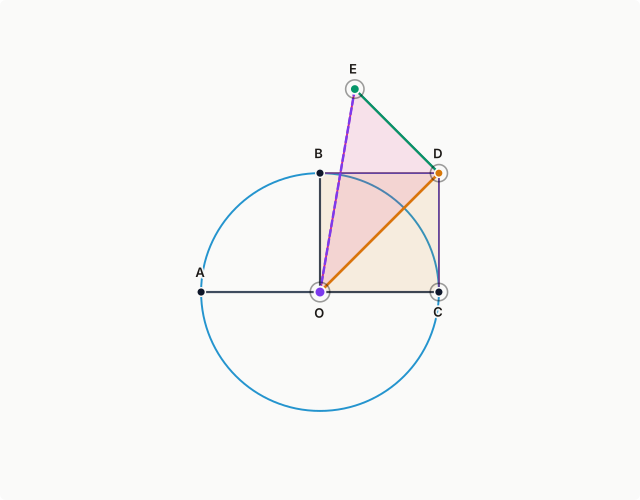

GEOMETOR • plato
================

**Visit the Online Archive:** https://geometor.github.io/plato/

**Plato • Meno, Theaetetus, Republic, Timaeus, Dialogues on Measure • semantic digital archive**

Mission
-------

``geometor/plato`` is part of the interconnected `GEOMETOR <https://geometor.com>`_ semantic digital archive. Plato's dialogues established the dialectical foundation of mathematical hypothesis, quadratic powers, the Divided Line, harmonic proportion, the regular polyhedra, and cosmic limit. Within this archive, the foundational mathematical and geometric passages across Plato's dialogues are liberated from isolated print bounds into addressable semantic units, synchronized 4-track bilingual codices, calibrated vector diagrams, and exact symbolic formulations across the GEOMETOR corpus.

Books in This Archive
---------------------

- `Dialogues on Measure & Proportion <https://geometor.github.io/plato/foundations/>`_ — Parmenides, Philebus, and Laws VII on straightness, limit, dimensional surd towers, and incommensurability.
- `Meno <https://geometor.github.io/plato/meno/>`_ — Virtue, anamnesis, doubling the square by its diagonal, and geometric hypothesis.
- `Republic <https://geometor.github.io/plato/republic/>`_ — The Divided Line, the Quadrivium curriculum, dianoia, and the Nuptial Number.
- `Theaetetus <https://geometor.github.io/plato/theaetetus/>`_ — Theodorus's spiral of surds, incommensurable dynameis, and the nature of mathematical knowledge.
- `Timaeus <https://geometor.github.io/plato/timaeus/>`_ — The proportional bond of the World-Soul, musical ratios, and the elementary cosmic polyhedra.

Repository Contents
-------------------

- ``docsrc/`` — 4-track synchronized Book Codex tracks, concordance, glossary, and scholarly apparatus compiled by `PHOTON publish <https://github.com/photon-platform/publish>`_.
- ``resources/`` — Curated Greek and English sources, citation registries, and Stephanus concordance data.
- ``src/geometor/plato/`` — Exact SymPy construction modules, CLI tools, and harmonic verification algorithms.

Local Build & Verification
--------------------------

.. code-block:: bash

   publish build
   uv run --no-sync pytest

Part of the GEOMETOR Knowledge Archive
--------------------------------------

Explore all **74 Book Codices** and **11 Mathematical Catalogs** at https://geometor.com/books/.
