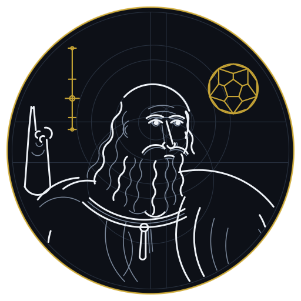

:site_title: Plato

.. container:: author-overline

   semantic digital archive • the works of

.. _plato:
.. _plato-index:
.. _loci-mathematici:
.. _loci-mathematici-index:

=====
Plato
=====

:person:`Plato of Athens <plato>` (c. 427–347 BCE) placed geometry at the threshold of philosophy—not as a craft of mere measurement, but as the dialectical discipline that trains the soul to move from visible figures to intelligible proportion, limit, and unity. This digital edition gathers the foundational mathematical and geometric dialogues across **fourteen Stephanus passages**, pairing John Burnet's Oxford Classical Texts Greek with Benjamin Jowett's 1892 translation, step-by-step argumentative summaries, and interactive vector diagrams.

Books in This Collection
------------------------

.. container:: home-book-hero

   .. container:: home-book-thumb

      .. image:: _static/figures/meno_diagonal_doubling.svg
         :alt: Doubling the Square by Its Diagonal in Plato's Meno
         :target: meno/index.html

   .. container:: home-book-body

      .. rubric:: Dialogue · Stephanus 75d–87b · 3 Passages · 4 Tracks

      **Meno** — Socrates defines figure as the limit of solid (`75d–76a`), guides the slave boy to double a square by constructing a new square upon its diagonal (`82b–85b`), and introduces the geometer's method of hypothesis (`86e–87b`).

      .. container:: home-actions

         * :doc:`Open Meno → <meno/index>`
         * :doc:`Doubling the Square (82b–85b) → <meno/82b-85b/index>`
         * :doc:`Method of Hypothesis (86e–87b) → <meno/86e-87b/index>`

.. container:: home-book-hero

   .. container:: home-book-thumb

      .. image:: _static/figures/theodorus_spiral.svg
         :alt: Theodorus's Spiral of Square Roots in Plato's Theaetetus
         :target: theaetetus/index.html

   .. container:: home-book-body

      .. rubric:: Dialogue · Stephanus 147d–148b · 1 Passage · 4 Tracks

      **Theaetetus** — Theodorus of Cyrene constructs geometric lines whose squares span from 3 to 17 square feet, prompting young Theaetetus to classify rational *lengths* (*mēkē*) and incommensurable *powers* (*dynameis*).

      .. container:: home-actions

         * :doc:`Open Theaetetus → <theaetetus/index>`
         * :doc:`Theodorus's Irrationals (147d–148b) → <theaetetus/147d-148b/index>`

.. container:: home-book-hero

   .. container:: home-book-thumb

      .. image:: _static/figures/republic_divided_line.svg
         :alt: The Divided Line from Plato's Republic Book VI
         :target: republic/index.html

   .. container:: home-book-body

      .. rubric:: Dialogue · Books VI–VIII · 3 Passages · 4 Tracks

      **Republic** — The proportional Divided Line bridges visible image and intelligible form (`509d–511e`), the Quadrivium and stereometry chart the mathematical ascent of the soul (`522c–534e`), and the geometric Nuptial Number closes Book VIII's cosmic cycle (`546b–d`).

      .. container:: home-actions

         * :doc:`Open Republic → <republic/index>`
         * :doc:`The Divided Line (509d–511e) → <republic/509d-511e/index>`
         * :doc:`The Quadrivium (522c–534e) → <republic/522c-534e/index>`

.. container:: home-book-hero

   .. container:: home-book-thumb

      .. image:: _static/figures/timaeus_world_soul.svg
         :alt: Proportional Bond of the World-Soul in Plato's Timaeus
         :target: timaeus/index.html

   .. container:: home-book-body

      .. rubric:: Dialogue · Stephanus 31b–56c · 2 Passages · 4 Tracks

      **Timaeus** — Timaeus of Locri weaves the World-Soul from geometric, harmonic, and arithmetic means into a 34-pitch diatonic scale (`31b–36d`), then assembles the four elements and cosmos from elementary right triangles into the five regular polyhedra (`53c–56c`).

      .. container:: home-actions

         * :doc:`Open Timaeus → <timaeus/index>`
         * :doc:`The World-Soul (31b–36d) → <timaeus/31b-36d/index>`
         * :doc:`Elementary Polyhedra (53c–56c) → <timaeus/53c-56c/index>`

.. container:: home-book-hero

   .. container:: home-book-thumb

      .. image:: _static/figures/foundations_peras_compass.svg
         :alt: Geometric Limit and Straightness across Parmenides, Philebus, and Laws VII
         :target: foundations/index.html

   .. container:: home-book-body

      .. rubric:: Thematic Anthology · 5 Passages · 4 Tracks

      **Dialogues on Measure & Proportion** — Late dialogues probing the optical definition of straightness and roundness in *Parmenides* (`137d–138a`, `145a–b`), Limit (*peras*) and pure geometric beauty in *Philebus* (`16c–26d`, `51b–52c`), and linear, planar, and solid incommensurability in *Laws* VII (`817e–820d`).

      .. container:: home-actions

         * :doc:`Open Measure & Proportion → <foundations/index>`
         * :doc:`Parmenides on Straightness → <foundations/parmenides-137d-138a/index>`
         * :doc:`Laws VII on Incommensurability → <foundations/laws-817e-820d/index>`

Key Features
------------

.. container:: home-feature-grid

   .. container:: home-feature-card

      **Four Synchronized Tracks**

      Every passage aligns verbatim Burnet Greek (Oxford Classical Texts), Jowett's 1892 English translation, structural summaries, and mathematical-philological notes calibrated to exact Stephanus ``a–e`` markers.

   .. container:: home-feature-card

      **Interactive Vector Diagrams**

      Explore calibrated ``.euclid-graphic`` reconstructions of Meno's doubled square, Theodorus's surd spiral, the Divided Line, Timaeus's World-Soul means and triangles, and the compass of Limit.

   .. container:: home-feature-card

      **58 Cross-Corpus Citations**

      Follow Plato's mathematical terminology and propositions across Euclid's *Elements*, Proclus's *Commentary*, Aristotle, Pacioli, and Hoenen through the :doc:`Master Stephanus Concordance <concordance>`.

Reference & Project
-------------------

.. container:: home-columns

   .. container:: home-col

      .. rubric:: Scholarly Apparatus

      * :doc:`Master Stephanus Concordance <concordance>` — Cross-corpus reconciliation of all 58 Platonic mathematical citations
      * :doc:`Glossary <glossary>` — Polytonic Greek, Scholastic Latin, and geometric lexicon
      * :doc:`People <people/index>` & :doc:`Bibliography <bibliography>` — Biographical profiles and critical editions (Burnet OCT, Jowett)

   .. container:: home-col

      .. rubric:: About This Project

      * :doc:`About <about/index>` & :doc:`Burnet & Jowett <about/burnet-and-jowett>` — Editorial scope and textual witnesses
      * :doc:`Using This Edition <usage/index>` & :doc:`Symbolic Demos <demos/index>` — Navigation guide and exact SymPy constructions in ``geometor.plato``
      * :doc:`Log <log/index>`, :doc:`Changelog <changelog>`, & :doc:`Modules <modules/index>` — Development notes, release history, and Python API

.. toctree::
   :hidden:
   :maxdepth: 2

   meno/index
   theaetetus/index
   republic/index
   timaeus/index
   foundations/index
   concordance
   glossary
   people/index
   bibliography
   usage/index
   about/index
   demos/index
   log/index
   changelog
   modules/index
